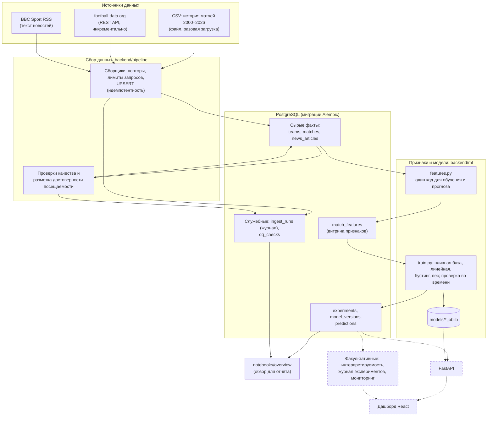

# Архитектура системы

Пунктирные блоки ещё не реализованы.



## Как запускается

```
docker compose run --rm --build pipeline                       сбор данных (+ миграции, база)
docker compose run --rm --build ml                              признаки
docker compose run --rm --build ml python -m ml.train           обучение, прогнозы
```

## Слои

| Слой | Где | Что делает |
|---|---|---|
| Источники и сбор | `backend/pipeline/` | Забирает данные, не дублирует, переживает сбои, пишет журнал |
| Хранилище | PostgreSQL, `backend/db/`, `backend/alembic/` | Сырые факты, журнал, результаты проверок, признаки, реестр моделей |
| Качество | `pipeline/quality.py` | Проверки и пометка недостоверных сезонов посещаемости |
| Признаки | `backend/ml/features.py` | Лаговые, оконные, календарные признаки без утечки из будущего |
| Модели | `backend/ml/train.py` и др. | Обучение, проверка во времени, реестр версий, прогнозы |
| Показ | `backend/api`, `frontend/` (план) | API и дашборд |
