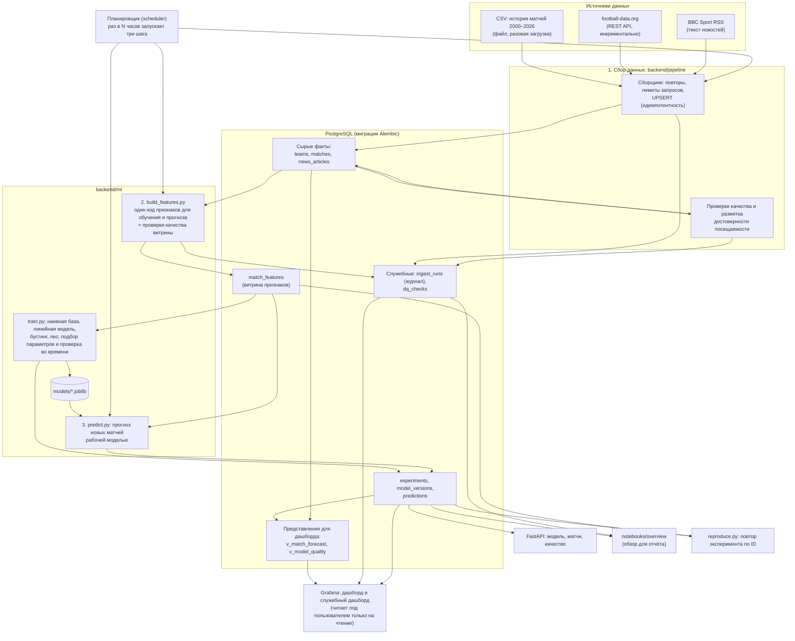

# Архитектура системы



## Как запускается

```
docker compose run --rm --build pipeline                       сбор данных (+ миграции, база)
docker compose run --rm --build ml                              признаки
docker compose run --rm --build ml python -m ml.train           обучение, выбор модели, прогнозы
docker compose up -d --build grafana api                        дашборд и API
docker compose --profile schedule up -d --build scheduler       регулярное обновление (по желанию)
```

## Слои

| Слой | Где | Что делает |
|---|---|---|
| Источники и сбор | `backend/pipeline/` | Забирает данные, не дублирует, переживает сбои, пишет журнал |
| Хранилище | PostgreSQL, `backend/db/`, `backend/alembic/` | Сырые факты, журнал, результаты проверок, признаки, реестр моделей |
| Качество | `pipeline/quality.py`, `ml/quality.py` | Проверки входных данных, разметка недостоверных сезонов, проверки витрины признаков |
| Признаки | `backend/ml/features.py` | Лаговые, оконные, календарные признаки без утечки из будущего |
| Модели | `backend/ml/train.py`, `predict.py` | Обучение и выбор модели, версии, прогноз новых матчей без переобучения |
| Показ | `grafana/`, `backend/api/` | Дашборды и API |
| Регулярность | `backend/scheduler.py` | Раз в N часов: сбор, признаки, прогноз |
