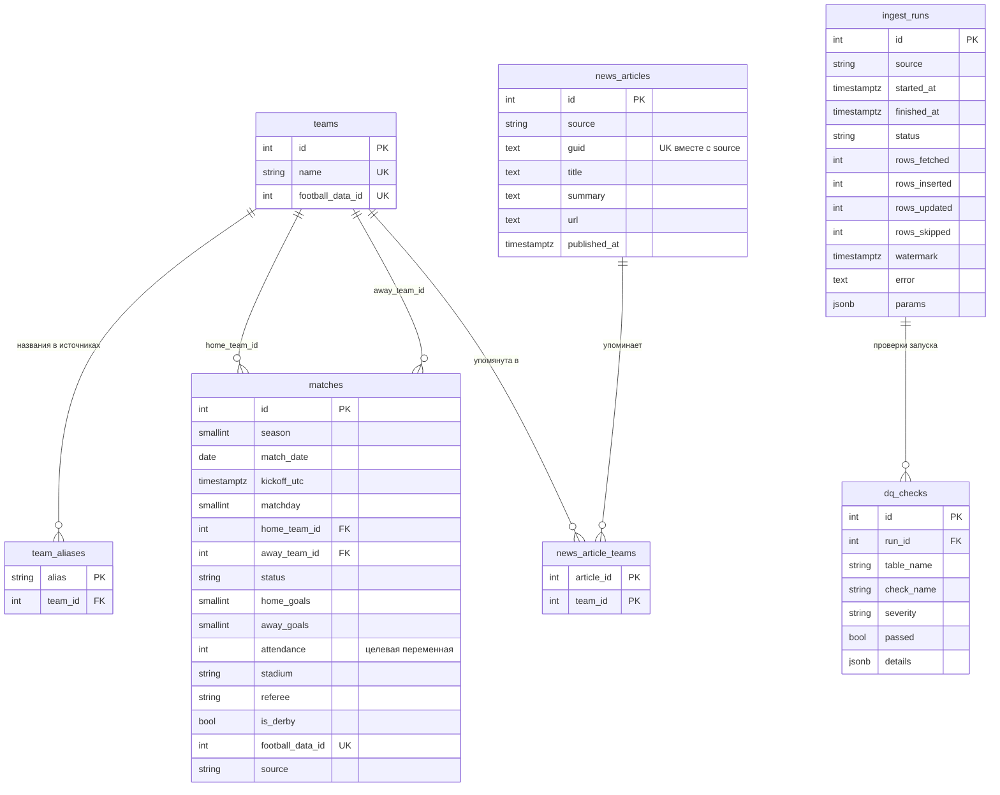

# Схема базы данных

Миграции: Alembic (`backend/alembic/versions`), модели: `backend/db/models.py`.
Применить: `docker compose run --rm migrate`.

## Ключевые решения

| Решение | Зачем |
|---|---|
| Внешние ключи на `teams.id`, а не на название | Источники называют клуб по-разному (`Man City` / `Manchester City FC`). Сопоставление делается один раз при загрузке через `team_aliases`. |
| `UNIQUE (season, home_team_id, away_team_id)` в `matches` | В чемпионате пара «хозяева–гости» встречается в сезоне ровно один раз. Это естественный ключ для UPSERT: исторический CSV и live-API описывают один и тот же матч и не создадут дубль. Отсюда идемпотентность. |
| `season` — число (год начала сезона: 2023 = 2023/24) | В CSV сезон записан строкой `"2324"`, pandas по умолчанию теряет ведущие нули (`"0001"` → `1`). Число однозначно и сортируется. |
| Итоги и посещаемость — колонки `matches`, а не отдельная таблица | Один матч = один результат (связь 1:1). |
| `attendance`, `home_goals`, `away_goals` допускают NULL | Будущие матчи из football-data.org ещё не сыграны. |
| Стадион хранится в матче, а не в клубе | Клубы меняют стадион (Вест Хэм в 2016 г.), для старых матчей значение клуба было бы неверным. |
| В БД хранятся только **сырые факты** | Позиция в таблице, форма, лаги и тональность вычисляются в слое признаков. Колонки CSV `SeasonPos*`/`SeasonPoints*`/`SeasonPlayed*` — это **итоговая** таблица сезона (`played = 38` в каждой строке), использовать их как признаки нельзя: это утечка из будущего. |
| Новости привязаны к клубам через `news_article_teams` (M:N), а не к матчу | Статья про трансфер или травму не относится к одному матчу и может упоминать несколько клубов. Окно «новости клуба за N дней до матча» собирается на этапе признаков. |
| `UNIQUE (source, guid)` в `news_articles` | Идемпотентная загрузка RSS: повторный запуск не дублирует статьи. |
| `ingest_runs` с `watermark` | Журнал загрузок (требование задания) и точка, с которой нужно догружать данные при следующем запуске (инкрементальность). |
| `dq_checks` | Контроль качества данных (требование задания): результаты проверок сохраняются и привязаны к запуску. |

## Что добавится следующими миграциями

- `0002`: `model_versions` (реестр моделей), `predictions`, таблицы для журнала экспериментов и мониторинга.
